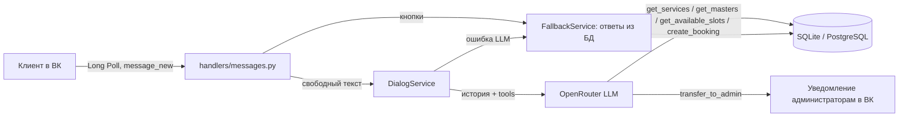

# VK Salon AI Concierge

ИИ-консьерж салона красоты в сообщениях сообщества ВКонтакте: показывает цены и свободное время из базы, записывает клиента через LLM и зовёт живого администратора, когда бот не справляется.

## Что делает и кому нужно

Клиент пишет в сообщения сообщества салона. Бот:

- по кнопкам **«Услуги и цены»**, **«Свободное время»**, **«Записаться»** отвечает сразу из базы, без обращения к модели;
- на свободный текст отвечает через LLM (OpenRouter), а цены, мастеров и слоты модель берёт только из базы через инструменты (tool calling);
- создаёт запись, если клиент назвал услугу, дату, время и телефон;
- по кнопке **«Администратор»** или словам «администратор», «менеджер», «живой человек» передаёт диалог людям: каждому администратору приходит уведомление с кнопками «Взять диалог» / «Завершить»;
- если OpenRouter недоступен, отвечает по ключевым словам из базы (услуги, запись, свободное время, мастера, адрес).

Подходит небольшому салону, барбершопу или студии маникюра, которые принимают записи в сообщениях ВК и не успевают отвечать вечером и в выходные.

## Как это работает



1. VKBottle получает `message_new` по Long Poll. Повторная доставка того же сообщения отсекается таблицей `processed_vk_messages`, второй экземпляр бота не стартует из-за `data/bot.lock`.
2. Кнопки и короткие приветствия обрабатываются без модели.
3. Свободный текст уходит в модель вместе с системным промптом (`app/prompts/system_prompt.txt`, данные салона из `.env`) и последними `DIALOG_HISTORY_LIMIT` сообщениями диалога из базы. Модель может вызвать до 5 раундов инструментов.
4. `create_booking` проверяет, что услуга и мастер есть в базе и время не занято, и сохраняет запись со статусом `pending`.
5. Передача администратору: запрос сохраняется в `admin_transfers`, администраторы получают ссылку `vk.com/id…` и причину. Пока администратор «взял диалог», бот не отвечает клиенту по существу. Клиент пишет «отмена» — снова говорит с ботом.

## Быстрый старт

Нужен Python 3.11 или новее (используется `enum.StrEnum`).

**Windows (PowerShell):**

```powershell
git clone https://github.com/nifontovoleg/vk-salon-ai-concierge.git
cd vk-salon-ai-concierge
python -m venv .venv
.\.venv\Scripts\pip install -r requirements.txt
copy .env.example .env   # заполнить VK_GROUP_TOKEN, VK_GROUP_ID, OPENROUTER_API_KEY, SEED_ADMIN_VK_IDS
.\.venv\Scripts\python -m scripts.seed
.\.venv\Scripts\python -m app.main
```

**macOS / Linux:**

```bash
git clone https://github.com/nifontovoleg/vk-salon-ai-concierge.git
cd vk-salon-ai-concierge
python3 -m venv .venv
.venv/bin/pip install -r requirements.txt
cp .env.example .env     # заполнить ключи
.venv/bin/python -m scripts.seed
.venv/bin/python -m app.main
```

`scripts.seed` создаёт базу и демо-данные: 3 услуги, 2 мастера и администраторов из `SEED_ADMIN_VK_IDS`. Если услуги в базе уже есть, скрипт ничего не делает.

`scripts.maintenance` заново активирует администраторов из `SEED_ADMIN_VK_IDS` и закрывает все зависшие передачи администратору. Запускайте его, если добавили администратора после первого seed или клиент «застрял» в режиме администратора.

**Docker:**

```bash
cp .env.example .env
docker compose run --rm bot python -m scripts.seed
docker compose up -d --build
```

База лежит в `./data` на хосте.

## Настройка сообщества ВК

В «Управление → Сообщения» включите сообщения сообщества и «Возможности ботов» (нужны для клавиатуры). В «Работа с API» создайте ключ с правом на сообщения, включите Long Poll API и событие «Входящее сообщение». Ключ запишите в `VK_GROUP_TOKEN`, числовой ID группы — в `VK_GROUP_ID`.

## Переменные окружения

| Переменная | Описание |
|---|---|
| `VK_GROUP_TOKEN`, `VK_GROUP_ID` | Ключ доступа и ID сообщества (обязательны) |
| `OPENROUTER_API_KEY` | Ключ OpenRouter (обязателен) |
| `OPENROUTER_MODEL` | Модель, по умолчанию `openai/gpt-4o-mini`, в примере `deepseek/deepseek-chat`. Нужна модель с поддержкой tools |
| `OPENROUTER_BASE_URL` | По умолчанию `https://openrouter.ai/api/v1`. Подойдёт другой OpenAI-совместимый `/chat/completions` |
| `OPENROUTER_TIMEOUT`, `OPENROUTER_MAX_TOKENS` | Таймаут запроса (с) и лимит токенов ответа |
| `DIALOG_HISTORY_LIMIT` | Сколько последних сообщений из базы уходит в модель (1–100, по умолчанию 20) |
| `DATABASE_URL` | `sqlite+aiosqlite:///./data/salon.db` или `postgresql+asyncpg://…` |
| `SALON_NAME`, `SALON_ADDRESS`, `SALON_PHONE`, `SALON_WORKING_HOURS` | Данные салона для промпта и для ответов без AI (адрес, телефон, часы) |
| `SEED_ADMIN_VK_IDS` | VK ID администраторов через запятую |
| `LOG_LEVEL` | Уровень логов |

Без обязательных переменных бот не стартует и пишет, что заполнить.

## Структура

```
app/
  main.py                запуск, Long Poll, корректная остановка
  config/settings.py     настройки из .env (pydantic-settings)
  handlers/messages.py   кнопки, передача администратору, уведомления
  services/
    dialog_service.py    логика диалога, вызов LLM и инструментов
    tools.py             инструменты для модели: услуги, мастера, слоты, запись, админ
    fallback_service.py  ответы из базы без LLM
    admin_service.py     администраторы и передачи
  clients/openrouter.py  HTTP-клиент OpenRouter
  db/                    модели SQLAlchemy и сессии
  repositories/          доступ к данным
  prompts/system_prompt.txt
scripts/seed.py          демо-данные
scripts/maintenance.py   администраторы и зависшие передачи
tests/                   pytest, SQLite в памяти, LLM подменяется моком
```

## Проверка

```bash
pip install -r requirements-dev.txt
python -m pytest -q
```

Тесты не ходят в ВК и OpenRouter. Проверяются: репозитории, дедупликация сообщений, инструменты (запись, занятое время, неизвестная услуга), кнопки без вызова модели, цикл tool calling с созданием записи, ответ из базы при падении OpenRouter, передача администратору и возврат «отмена», lock-файл.

## Что сделано / что нет

Сделано:

- Long Poll бот на VKBottle с клавиатурой и защитой от дублей;
- цены, мастера, слоты и запись из базы, модель цены не придумывает;
- передача администратору с уведомлением и кнопками «Взять диалог» / «Завершить»;
- ответы без AI, если OpenRouter недоступен;
- SQLite или PostgreSQL, Docker, тесты.

Не сделано:

- **Администратор не узнаёт о новой записи.** Запись сохраняется в базе со статусом `pending`, уведомления и подтверждения нет.
- Нет отмены и переноса записи клиентом, нет просмотра «мои записи».
- Слоты фиксированные: каждый час с 10:00 до 20:00. Длительность услуги, `SALON_WORKING_HOURS`, выходные, прошедшее время сегодня и часовой пояс не учитываются. `create_booking` принимает прошедшую дату и время вне сетки (например, 23:37).
- Если мастер не указан, занятость считается по всему салону, без привязки к мастеру.
- Нет админки для услуг, цен и мастеров: только `scripts.seed` или правка базы.
- Фото не анализируется: модель видит только пометку «[Клиент прислал фото]».
- Передача администратору по подстроке: «запишите двух **человек**» тоже уйдёт администратору. Слова «назад», «вернуться», «продолжить» в любом месте фразы снимают передачу.
- Если активных администраторов нет, клиент всё равно получает «Передал запрос администратору», уведомление никому не уходит (только предупреждение в логе).
- Пока администратор ведёт диалог, бот на каждое сообщение клиента отвечает «С вами на связи администратор…».
- Callback API нет, только Long Poll. Миграций (Alembic) нет: таблицы создаются при запуске.
- Работа с PostgreSQL заявлена через `asyncpg`, но тестами не покрыта.

## Персональные данные (152-ФЗ)

- В базе хранятся VK ID, телефон и имя клиента из записи и **полный текст диалога** (`dialog_messages`). Шифрования и срока хранения нет, удалять старые данные нужно вручную.
- Текст сообщений клиента вместе с историей уходит в OpenRouter, а через него — провайдеру модели за рубежом. Если клиент пишет телефон в чат, он тоже уходит в модель. Это трансграничная передача ПДн: маскирования и запроса согласия в боте нет.
- Для реального салона: согласие на обработку ПДн и политика в сообществе, уведомление РКН о трансграничной передаче, либо модель, размещённая в РФ, через `OPENROUTER_BASE_URL` (любой OpenAI-совместимый API с поддержкой tools).

## Хостинг

Боту не нужны домен и HTTPS: Long Poll сам опрашивает ВК. Достаточно небольшого VPS у российского провайдера, арендованного салоном на себя, и `docker compose up -d`. База — файл `data/salon.db` на этом сервере, запускайте строго один экземпляр бота на одно сообщество. Резервное копирование `data/` в проекте не настроено.

## Лицензия

[MIT](LICENSE)
