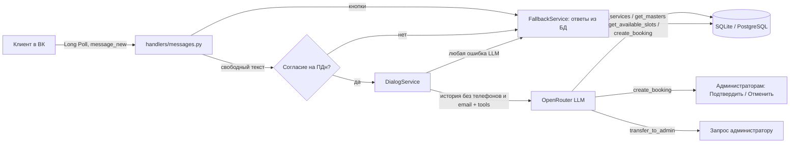

# VK Salon AI Concierge

ИИ-консьерж салона красоты в сообщениях сообщества ВКонтакте: показывает цены и свободное время из базы, записывает клиента через LLM, присылает запись администратору на подтверждение и зовёт живого администратора, когда бот не справляется.

## Что делает и кому нужно

Клиент пишет в сообщения сообщества салона. Бот:

- по кнопкам **«Услуги и цены»**, **«Свободное время»**, **«Записаться»** отвечает сразу из базы, без обращения к модели;
- на свободный текст отвечает через LLM (OpenRouter), а цены, мастеров и слоты модель берёт только из базы через инструменты (tool calling). Перед первым таким ответом спрашивает согласие на обработку персональных данных;
- создаёт запись, если клиент назвал услугу, дату, время и телефон. Время проверяется по сетке: часы салона и личный график мастера, выходные и отпуска, длительность услуги, часовой пояс, занятость мастера. Две одновременные записи на одно время не пройдут: запись идёт под блокировкой в базе;
- каждая запись приходит администраторам в ВК с кнопками **«Подтвердить» / «Отменить»**, клиент получает сообщение о результате;
- по кнопке **«Мои записи»** клиент видит свои будущие записи и может **отменить** или **перенести** их кнопками (или попросить в чате). Администраторы получают уведомление, перенесённая запись снова ждёт подтверждения;
- по кнопке **«Администратор»** или фразам «позовите администратора», «живой человек», «менеджер» передаёт диалог людям. Пока администратор ведёт диалог, бот молчит и пересылает ему сообщения клиента;
- если OpenRouter недоступен или вернул что-то непонятное, отвечает по ключевым словам из базы и не оставляет клиента без ответа.

Подходит небольшому салону, барбершопу или студии маникюра, которые принимают записи в сообщениях ВК и не успевают отвечать вечером и в выходные.

## Как это работает



1. VKBottle получает `message_new` по Long Poll. Повторная доставка того же сообщения отсекается таблицей `processed_vk_messages`, второй экземпляр бота не стартует из-за `data/bot.lock`.
2. Кнопки и короткие приветствия обрабатываются без модели.
3. Свободный текст уходит в модель только после согласия клиента (см. «Персональные данные»). Вместе с ним уходят системный промпт (`app/prompts/system_prompt.txt`, данные салона, текущие дата и время в `TIMEZONE`) и последние `DIALOG_HISTORY_LIMIT` сообщений диалога. Телефоны и email в тексте клиента заменяются на `[телефон]` / `[email]`. Модель может вызвать до 5 раундов инструментов. Битый JSON аргументов инструмента возвращается модели как ошибка, любое другое исключение — переход на ответ из базы.
4. `create_booking` проверяет услугу и мастера, отклоняет прошедшую дату, выходной салона или мастера, время вне сетки и пересечение с другими записями мастера. Сетка мастера — пересечение часов салона и его личного графика. Если мастер не указан, назначается первый свободный. Телефон берётся из сообщения клиента, даже если модель видела только метку `[телефон]`. Запись сохраняется со статусом `pending`.
   - **Без гонок.** Проверка свободного времени и запись выполняются в отдельной короткой транзакции, которая начинается с записи в строку `booking_day_locks` для этой даты. В PostgreSQL это блокировка строки до конца транзакции (как `SELECT … FOR UPDATE`), в SQLite — блокировка записи базы (как `BEGIN IMMEDIATE`). Второй клиент ждёт и затем видит уже созданную запись. Дополнительно частичный уникальный индекс `uq_bookings_active_master_start` не даёт мастеру двух активных записей с одним началом. Если время заняли, клиент получает «Выбранное время уже занято» и три ближайших свободных слота.
5. Администраторы (`SEED_ADMIN_VK_IDS`) получают карточку записи: услуга, цена, длительность, мастер, дата и время, имя, телефон и ссылка на клиента. «Подтвердить» → `confirmed`, «Отменить» → `cancelled` (слот освобождается). Клиенту приходит сообщение с результатом. Повторное нажатие ничего не меняет.
6. Передача администратору: запрос сохраняется в `admin_transfers`, администраторам приходит уведомление с кнопками «Взять диалог» / «Завершить». Взявший диалог администратор получает пересланные сообщения клиента и ссылку на диалог в сообщениях сообщества (`vk.com/gim<ID>?sel=<клиент>`), отвечать нужно оттуда. Второй администратор тот же диалог взять не может. Если администраторов нет, бот честно об этом говорит и даёт телефон, адрес и часы работы салона.
7. «Мои записи»: список будущих записей клиента (до 5) с кнопками «Отменить #N» / «Перенести #N». «Перенести» показывает до 8 ближайших свободных слотов того же мастера с учётом длительности услуги; выбор слота переносит запись и возвращает её в `pending`. Тот же сценарий доступен в чате через инструменты `list_my_bookings`, `cancel_booking`, `reschedule_booking`. Менять можно только свои будущие активные записи и не позже чем за `CANCEL_MIN_HOURS` часов до начала — иначе бот просит позвонить в салон. Администраторам приходит «Клиент отменил запись #N» или «Клиент перенёс запись #N (было: …)» с кнопками подтверждения. Кнопки и команда «мои записи» работают без согласия на ПДн: это ответы из базы.
8. Вернуться к боту: кнопка «Вернуться к боту» или сообщение целиком «отмена», «назад», «вернуться к боту», «к боту». Слова внутри фразы («перенесите назад на час») передачу не снимают.

## Быстрый старт

Нужен Python 3.11 или новее (используется `enum.StrEnum`).

**Windows (PowerShell):**

```powershell
git clone https://github.com/nifontovoleg/vk-salon-ai-concierge.git
cd vk-salon-ai-concierge
python -m venv .venv
.\.venv\Scripts\pip install -r requirements.txt
copy .env.example .env   # заполнить VK_GROUP_TOKEN, VK_GROUP_ID, OPENROUTER_API_KEY, SEED_ADMIN_VK_IDS, PRIVACY_POLICY_URL
.\.venv\Scripts\python -m scripts.seed
.\.venv\Scripts\python -m app.main
```

**macOS / Linux:**

```bash
git clone https://github.com/nifontovoleg/vk-salon-ai-concierge.git
cd vk-salon-ai-concierge
python3 -m venv .venv
.venv/bin/pip install -r requirements.txt
cp .env.example .env     # заполнить ключи
.venv/bin/python -m scripts.seed
.venv/bin/python -m app.main
```

`scripts.seed` создаёт базу и демо-данные: 3 услуги и 2 мастера с графиками (Анна — Пн-Пт 10:00-18:00, Дмитрий — Ср-Вс 12:00-20:00). Если услуги в базе уже есть, скрипт ничего не делает. Администраторы из `SEED_ADMIN_VK_IDS` активируются при каждом запуске бота. Если список пуст, в логе будет предупреждение, а записи и запросы останутся без уведомлений.

`scripts.maintenance` закрывает все зависшие передачи администратору и заново активирует администраторов из `SEED_ADMIN_VK_IDS`.

**Docker:**

```bash
cp .env.example .env
docker compose run --rm bot python -m scripts.seed
docker compose up -d --build
```

База лежит в `./data` на хосте.

## Настройка сообщества ВК

В «Управление → Сообщения» включите сообщения сообщества и «Возможности ботов» (нужны для клавиатуры). В «Работа с API» создайте ключ с правом на сообщения, включите Long Poll API и событие «Входящее сообщение». Ключ запишите в `VK_GROUP_TOKEN`, числовой ID группы — в `VK_GROUP_ID`. Каждый администратор должен хотя бы раз написать сообществу, иначе ВК не даст боту прислать ему уведомление.

## Переменные окружения

| Переменная | Описание |
|---|---|
| `VK_GROUP_TOKEN`, `VK_GROUP_ID` | Ключ доступа и ID сообщества (обязательны) |
| `OPENROUTER_API_KEY` | Ключ OpenRouter (обязателен) |
| `OPENROUTER_MODEL` | Модель, по умолчанию `openai/gpt-4o-mini`, в примере `deepseek/deepseek-chat`. Нужна модель с поддержкой tools |
| `OPENROUTER_BASE_URL` | По умолчанию `https://openrouter.ai/api/v1`. Подойдёт другой OpenAI-совместимый `/chat/completions` |
| `OPENROUTER_TIMEOUT`, `OPENROUTER_MAX_TOKENS` | Таймаут запроса (с) и лимит токенов ответа |
| `DIALOG_HISTORY_LIMIT` | Сколько последних сообщений из базы уходит в модель (1–100, по умолчанию 20) |
| `DATABASE_URL` | `sqlite+aiosqlite:///./data/salon.db` или `postgresql+asyncpg://…` |
| `SALON_NAME`, `SALON_ADDRESS`, `SALON_PHONE` | Данные салона для промпта, ответов без AI и сообщения «администраторов нет» |
| `SALON_WORKING_HOURS` | Часы работы, по ним строится сетка: `Пн-Сб 10:00-20:00, Вс 11:00-18:00`. Разделители `,` или `;`, дни `Пн`…`Вс`, диапазоны `Пн-Пт`, слово `ежедневно`. Дни, которых нет в строке, — выходные. Пусто или не распознано — ежедневно 10:00–20:00 (с предупреждением в логе) |
| `TIMEZONE` | Часовой пояс салона, по умолчанию `Asia/Yekaterinburg`. От него считаются «сегодня» и прошедшее время |
| `SLOT_STEP_MINUTES` | Шаг сетки записи, по умолчанию 60. Последний слот — тот, где услуга целиком укладывается до закрытия |
| `SALON_DAYS_OFF` | Нерабочие даты салона: `2026-12-31, 2027-01-01..2027-01-03` (также `31.12.2026`) |
| `MASTER_SCHEDULES` | Личные графики: `Анна=Пн-Ср 10:00-18:00 \| Дмитрий=Чт-Вс 12:00-20:00`. Применяются к мастерам в базе при каждом запуске. Рабочее время мастера — пересечение с часами салона. Мастер без графика работает по часам салона |
| `MASTER_DAYS_OFF` | Отпуска и выходные мастеров: `Анна=2026-11-02, 2026-11-10..2026-11-15 \| Дмитрий=31.12.2026` |
| `CANCEL_MIN_HOURS` | За сколько часов до начала клиент ещё может отменить или перенести запись онлайн (по умолчанию 2, `0` — без ограничения) |
| `SEED_ADMIN_VK_IDS` | VK ID администраторов через запятую. Активируются при запуске, получают записи и запросы |
| `REQUIRE_CONSENT` | `true` (по умолчанию): без согласия на ПДн свободный текст не уходит в модель |
| `PRIVACY_POLICY_URL` | Ссылка на политику обработки ПДн салона в запросе согласия. Пусто — бот предложит запросить политику у администратора, в логе предупреждение |
| `MASK_PII` | `true` (по умолчанию): телефоны и email в тексте клиента заменяются метками перед отправкой в модель |
| `LOG_LEVEL` | Уровень логов |

Без обязательных переменных бот не стартует и пишет, что заполнить.

Графики мастеров хранятся в таблице `masters` (`working_hours`, `days_off`). Их можно задать в `scripts/seed.py` (`SEED_MASTERS`), правкой базы или через `MASTER_SCHEDULES` / `MASTER_DAYS_OFF` в `.env` — значения из `.env` перезаписывают базу при запуске, мастера, которых нет в `.env`, не меняются. Неизвестное имя или нераспознанный график — предупреждение в логе.

## Структура

```
app/
  main.py                запуск, синхронизация администраторов, Long Poll, корректная остановка
  config/settings.py     настройки из .env (pydantic-settings)
  handlers/messages.py   кнопки, уведомления, подтверждение записей, пересылка администратору
  privacy.py             маскировка телефонов и email, фильтр логов
  services/
    dialog_service.py    логика диалога: согласие, передача администратору, вызов LLM и инструментов
    tools.py             инструменты для модели: услуги, мастера, слоты, запись, админ
    schedule.py          часы салона и мастеров, выходные, сетка записи, пересечения
    booking_service.py   запись под блокировкой, отмена/перенос клиентом, подтверждение, тексты уведомлений
    fallback_service.py  ответы из базы без LLM
    admin_service.py     администраторы и передачи
  clients/openrouter.py  HTTP-клиент OpenRouter
  db/                    модели SQLAlchemy, сессии, мини-миграции
  repositories/          доступ к данным
  prompts/system_prompt.txt
scripts/seed.py          демо-данные
scripts/maintenance.py   администраторы и зависшие передачи
tests/                   pytest, SQLite в памяти/во временном файле, LLM и VK API подменяются
```

## Проверка

```bash
pip install -r requirements-dev.txt
python -m pytest -q
```

Тесты не ходят в ВК и OpenRouter. Проверяются: гонка записи в реальных потоках на общем файле SQLite (6 клиентов на один слот — проходит один, остальные получают ближайшие слоты; пересекающиеся записи с разным началом; автоназначение двух мастеров), уникальный индекс, миграция старой базы, «Мои записи», отмена и перенос кнопками и через инструменты, чужие и прошедшие записи, ограничение `CANCEL_MIN_HOURS`, уведомления администраторам об отмене и переносе, графики мастеров (пересечение с часами салона, отпуск, праздники салона, синхронизация из `.env`), разбор часов работы, сетка с учётом длительности, прошедшего времени и часового пояса, отказ в записи на прошлое, на выходной и вне сетки, пересечения по мастеру и автоназначение мастера, уведомление администраторам и подтверждение/отмена с сообщением клиенту, триггеры передачи администратору («двух человек» не срабатывает), команды возврата, честный ответ без администраторов, молчание бота и пересылка во время передачи, битый JSON инструмента и любые ошибки LLM, согласие и его отзыв, маскировка в логах и в тексте для модели, отсутствие обещаний анализа фото в промпте.

## Что сделано / что нет

Сделано:

- Long Poll бот на VKBottle с клавиатурой и защитой от дублей;
- цены, мастера, слоты и запись из базы, модель цены не придумывает;
- сетка записи по часам работы, длительности услуги и часовому поясу, без пересечений у мастера;
- уведомление администраторам о каждой записи, подтверждение и отмена кнопками, сообщение клиенту;
- запись без гонок: блокировка дня в транзакции (SQLite и PostgreSQL) плюс уникальный индекс, при конфликте — ближайшие свободные слоты;
- «Мои записи»: отмена и перенос своей записи клиентом кнопками и в чате, ограничение `CANCEL_MIN_HOURS`, уведомления администраторам;
- личные графики, выходные и отпуска мастеров, праздники салона;
- передача администратору по целым словам и фразам, пересылка сообщений взявшему диалог администратору;
- честный ответ с контактами салона, если администраторов нет;
- ответ из базы при любой ошибке LLM;
- согласие на ПДн, отзыв согласия с удалением истории, маскировка телефонов и email в логах и в тексте для модели;
- SQLite или PostgreSQL, Docker, тесты.

Не сделано:

- Ответ администратора клиенту идёт через сообщения сообщества ВК, бот его не пересылает в обратную сторону.
- Нет админки для услуг, цен и мастеров: только `scripts.seed`, `.env` (графики) или правка базы. Перерывы внутри дня (обед) не задаются.
- Если мастеру поменяли график или отпуск, уже существующие записи не проверяются заново — их нужно перенести вручную.
- Напоминаний клиенту перед визитом нет.
- Фото не анализируются: модель видит только пометку «[Клиент прислал фото]» и прямо говорит об этом клиенту.
- Callback API нет, только Long Poll. Alembic нет: таблицы и пара недостающих колонок создаются при запуске.
- Работа с PostgreSQL (в том числе блокировка строки дня) заявлена через `asyncpg`, но тестами не покрыта: гонки проверены только на SQLite.
- Работа с настоящими API ВК и OpenRouter проверена только моками в тестах.

## Персональные данные (152-ФЗ)

- **Согласие.** При `REQUIRE_CONSENT=true` (по умолчанию) свободный текст не уходит в модель, пока клиент не нажмёт «Согласен» или не напишет «согласен». В запросе есть ссылка `PRIVACY_POLICY_URL`. Факт, время и ссылка на политику сохраняются в `client_consents`. До согласия текст клиента в базу не сохраняется, работают только кнопки, ответы из базы (услуги, свободное время, мастера, адрес, «Мои записи» с отменой и переносом) и вызов администратора. Запись через чат требует согласия.
- **Отзыв.** Сообщение «отозвать согласие» удаляет согласие и всю историю переписки клиента с ботом. Записи (`bookings`) остаются: они нужны салону для оказания услуги.
- **Маскировка.** При `MASK_PII=true` телефоны и email в тексте клиента и в его истории заменяются на `[телефон]` / `[email]` перед отправкой в OpenRouter. Настоящий номер подставляется в запись локально. Имена не маскируются. Фильтр логов маскирует телефоны и email во всех записях лога всегда.
- **Что хранится.** В базе лежат VK ID, телефон и имя из записи, история диалога после согласия. Шифрования и автоматического срока хранения нет.
- **Трансграничная передача.** Даже после маскировки текст переписки уходит в OpenRouter и провайдеру модели за рубежом. Для реального салона нужны своя политика ПДн, уведомление РКН о трансграничной передаче или модель, размещённая в РФ, через `OPENROUTER_BASE_URL` (любой OpenAI-совместимый API с поддержкой tools).

## Хостинг

Боту не нужны домен и HTTPS: Long Poll сам опрашивает ВК. Достаточно небольшого VPS у российского провайдера, арендованного салоном на себя, и `docker compose up -d`. База — файл `data/salon.db` на этом сервере, запускайте строго один экземпляр бота на одно сообщество. Резервное копирование `data/` в проекте не настроено.

## Лицензия

[MIT](LICENSE)
